<p align="center">
  
</p>

<h1 align="center">GLeaks</h1>

<p align="center">
  <b>Know where your data has leaked.</b><br>
  A native GNOME app that reconstructs your public footprint: breaches, profile pages and web mentions.<br>
  Encrypted on your disk, every step logged. No account, no cloud, and no API key required.
</p>

<p align="center">
  <a href="LICENSE"></a>
  
  
  
</p>

<p align="center">
  <a href="https://github.com/openapi/gleaks/actions/workflows/ci.yml"></a>
  
  
  
  
  
  <a href="CONTRIBUTING.md"></a>
</p>

<p align="center">
  
</p>

<p align="center"><sub>
  The real scan engine and connectors, fed with simulated responses and fictional identifiers.
  Regenerate with <code>make demo-svg</code>.
</sub></p>

## What it does

Add the identifiers that are yours, such as an email address, a nickname or your name. GLeaks checks them with several independent sources and keeps what it learns in one encrypted file.

| Source | Type | Accepts | Key | Finds |
|---|---|---|---|---|
| **Profile index** | GLeaks tool | nickname, email | none | Which of 28 sites have a page with that name, such as `github.com/yourname` |
| **Web search** | GLeaks tool | email, nickname, name | none | Public pages that mention the exact identifier |
| **Have I Been Pwned** | Third-party service | email | your own, paid | Known data breaches that include the address |

Sources run side by side and never wait for each other. If one fails, the others carry on. Without a key, Have I Been Pwned is simply skipped.

## Slow on purpose

GLeaks' own tools never flood the web. They make one request at a time, 30 seconds apart by default, across all searches. A nickname takes around a quarter of an hour, and that is the point.

- **Pause, resume, cancel** any search from the Activity tab.
- **Picks up where it stopped.** Progress lives in your profile, so a search survives closing the app and continues the next time you open it.
- **Background searches.** Mark a search to keep going after the window closes. GLeaks stays running until it finishes, with your profile unlocked in memory, and you can reopen it at any time.
- **Automatic repeats.** Run the searches every day, week or month while GLeaks is open or in the background.
- **Backs off when asked.** A site that rate-limits or asks for a human check is left alone for hours before one more try, and after three attempts that step is reported as failed.

Have I Been Pwned is a paid API with its own limits, so it answers right away.

## Built to be trusted

- **You approve every scan.** Before anything leaves your computer, GLeaks shows what will be sent and to whom.
- **Every step is logged.** The Activity tab shows, source by source, each query sent and each answer received.
- **Encrypted, in one file.** A `.gleaks` profile is AES-256-GCM encrypted and moves between computers. It is never on disk in clear, not even temporarily.
- **An error is never "all clear".** A failed or blocked check is reported as failed, and a site that gives an unclear answer is marked as unknown.
- **Facts, not scores.** Nothing is rated. Events stay in your history, next to suggested actions you can track.

## Limits worth knowing

- A page with your nickname may belong to someone else. GLeaks reports that it exists and leaves the judgment to you.
- An empty result covers only what these sources can see. It does not prove nothing has leaked.
- Sites behind a login wall, such as Instagram, X, LinkedIn and Facebook, are not in the index, because they cannot be checked reliably without an account.
- Web search uses [Marginalia Search](https://marginalia-search.com), whose index is small and which can be slow, and DuckDuckGo, which has no public API and may ask for a human check. GLeaks then stops using it for that scan and gives you the link to run the search yourself.
- GLeaks is meant for your own identifiers. Please do not use it to look up other people.

## Install

No packaged release is out yet. On Ubuntu 24.04+ or Debian 13+, run it from source:

```bash
sudo apt install python3-gi python3-cryptography gir1.2-gtk-4.0 gir1.2-adw-1 gir1.2-secret-1
git clone https://github.com/openapi/gleaks && cd gleaks
make start
```

Or install it for your user with `make install`. Every push to `main` also builds an installable Flatpak, available as a [CI artifact](https://github.com/openapi/gleaks/actions/workflows/ci.yml).

## Development

```bash
make start        # start the app from the source tree
make test         # run the tests; the interface tests need a display
make check        # byte-compile and validate the desktop metadata
make check-sites  # check the profile index against the live sites
make demo-svg     # regenerate the animated preview
make deb          # build dist/gleaks_*_all.deb
make flatpak      # build and install the Flatpak
```

Adding a site to the index takes one entry in [`sites.json`](gleaks/providers/sites.json) and no code. See [CONTRIBUTING.md](CONTRIBUTING.md), the threat model in [SECURITY.md](SECURITY.md), and the product vision in [IDEA.md](IDEA.md).

## Credits

Breach data is provided by [Have I Been Pwned](https://haveibeenpwned.com). Web results come from [Marginalia Search](https://marginalia-search.com) and [DuckDuckGo](https://duckduckgo.com). GLeaks is independent and is not affiliated with any of them, nor with GNOME or Ubuntu.

## License

[MIT](LICENSE)
